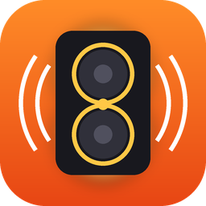
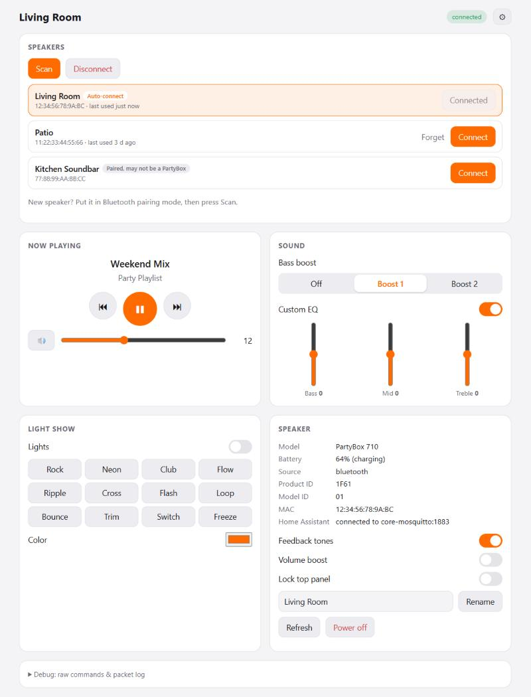
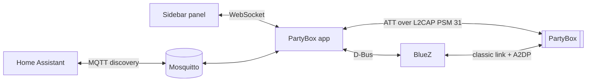

<div align="center">



# PartyBox for Home Assistant

**Control a JBL PartyBox speaker from Home Assistant over Bluetooth, no phone app needed.**

[](https://github.com/BaggaBruh/jbl-partybox-ha/actions/workflows/tests.yml)


<picture>
  <source media="(prefers-color-scheme: dark)" srcset="docs/screenshot-dark.png">
  
</picture>

</div>

## Features

- 🎚️ **Sound**: volume (0–32), mute, bass boost, 3-band custom EQ
- ⏯️ **Playback**: play, pause, next, previous, with song, artist and status
- 💡 **Light show**: on/off, 12 patterns, any RGB colour
- ⚙️ **Speaker settings**: feedback tones, volume boost, top-panel lock, rename, power off
- 🏠 **Automations**: 22 MQTT-discovered entities, credentials picked up from the Mosquitto app
- 🔁 **Stays connected**: reconnects in about 5–10 s after drop-outs, power cycles and restarts
- 🔀 **Speaker selection**: pair from the panel, remembered speakers, a choice of auto-connect
  speaker and Bluetooth adapter
- 🧩 **Model aware**: only offers the controls your speaker reports, with a health check for Bluetooth
- 🐞 **Debug console**: every frame sent and received, a raw-frame sender and a scrubbed diagnostics download

The protocol was reverse engineered from the official JBL PartyBox Android app (3.14.20);
see [PROTOCOL.md](PROTOCOL.md). Not affiliated with or endorsed by JBL/Harman.

> [!NOTE]
> This project was built with AI assistance. See the [AI disclaimer](#ai-disclaimer).

## Install

You need Home Assistant OS or Supervised, with a Bluetooth adapter in range of the speaker.

[](https://my.home-assistant.io/redirect/supervisor_add_addon_repository/?repository_url=https%3A%2F%2Fgithub.com%2FBaggaBruh%2Fjbl-partybox-ha)

1. Click the button above, or add `https://github.com/BaggaBruh/jbl-partybox-ha` under
   Settings → Apps → **App store** → ⋮ → **Repositories**.
2. Install **JBL PartyBox**, start it and enable **Show in sidebar**.

<details>
<summary>Manual install (local app)</summary>

Copy the [`jbl_partybox`](jbl_partybox) folder to `/addons/jbl_partybox` on the Home Assistant
host (for example through the **Samba share** app's `addons` share), then App store → ⋮ →
**Check for updates** and install it from *Local apps*.
</details>

## Use

1. Close the JBL PartyBox app on your phone (the speaker allows one control connection).
2. Open **PartyBox** in the sidebar → **Scan** → **Connect**, or **Pair and connect** for a speaker
   in pairing mode.

The speaker is remembered and reconnected automatically. See [DOCS.md](jbl_partybox/DOCS.md)
for options and troubleshooting.

## Home Assistant entities

With the Mosquitto app and the MQTT integration set up, the speaker appears as a device under
Settings → Devices & services → MQTT.

| Entity | Type |
|---|---|
| Connected | binary sensor (stays available while the speaker is off) |
| Volume, EQ bass/mid/treble | number |
| Mute, Custom EQ, Feedback tones, Volume boost, Lock top panel | switch |
| Bass boost (Off / Boost 1 / Boost 2) | select |
| Light show (on/off, RGB, patterns as effects) | light |
| Play, Pause, Next, Previous, Refresh, Power off | button |
| Player status, Song, Artist, Audio source, Battery, Charging | sensor |

Everything except **Connected** is unavailable while the speaker is disconnected. Raw topics
live under `partybox/<mac>/…`.

<details>
<summary><b>Example automation:</b> set the volume when the speaker connects</summary>

```yaml
automation:
  - alias: PartyBox start-up volume
    triggers:
      - trigger: state
        entity_id: binary_sensor.living_room_connected
        to: "on"
    actions:
      - action: number.set_value
        target:
          entity_id: number.living_room_volume
        data:
          value: 16
```

Entity IDs follow your speaker's name; check them under the MQTT device.
</details>

## How it works



The speaker speaks a small `AA <cmd> <len> <payload>` protocol over two GATT characteristics.
Once Home Assistant is connected to it for audio, it no longer shows those over BLE, so the app
opens the speaker's GATT database over **classic Bluetooth** instead. The speaker only keeps
that channel open on a link the *host* created, so every reconnect re-creates the link from
Home Assistant's side first. [PROTOCOL.md](PROTOCOL.md) has the details.

<details>
<summary><b>Options</b></summary>

| Option | Default | |
|---|---|---|
| `heartbeat_interval` | `5` | Seconds between keep-alive packets (the speaker may override this) |
| `scan_timeout` | `8` | Seconds per scan |
| `mqtt_discovery` | `true` | Publish the speaker to Home Assistant over MQTT |
| `discovery_prefix` | `homeassistant` | MQTT discovery prefix |
| `mqtt_host` / `mqtt_port` / `mqtt_username` / `mqtt_password` | | Only for a broker other than the Mosquitto app |
</details>

## Repository layout

| Path | |
|---|---|
| [`jbl_partybox/`](jbl_partybox) | The Home Assistant app: manifest, Dockerfile, docs, changelog |
| [`jbl_partybox/app/`](jbl_partybox/app) | Python source: protocol, BLE/ATT links, BlueZ helpers, MQTT bridge, web UI |
| [`PROTOCOL.md`](PROTOCOL.md) | The reverse-engineered protocol and connection behaviour |
| [`tests/`](tests) | Simulation tests (no Bluetooth needed) |
| [`tools/`](tools) | BLE test script, mock UI server, APK decompile helper, icon generator |
| [`AGENTS.md`](AGENTS.md) | Context for AI coding assistants |

## Development

```bash
pip install -r requirements-dev.txt
python tools/mock_server.py --demo     # UI against a simulated speaker on http://localhost:8099
python tests/run_all.py                # all simulation tests, on a simulated clock (a few seconds)
python tools/ble_test.py scan          # talk to a real speaker over BLE with bleak
```

Regenerating the decompiled APK is described in [tools/decompile](tools/decompile/README.md).
Bump `version` in [`jbl_partybox/config.yaml`](jbl_partybox/config.yaml) and add a
[changelog](jbl_partybox/CHANGELOG.md) entry with every change.

## Community

- 🔊 **[Tested models](https://github.com/BaggaBruh/jbl-partybox-ha/discussions/2)**: tell others whether it works on your PartyBox
- ❓ **[Q&A](https://github.com/BaggaBruh/jbl-partybox-ha/discussions/categories/q-a)**: questions and setup help
- 💡 **[Ideas](https://github.com/BaggaBruh/jbl-partybox-ha/discussions/categories/ideas)**: controls or features you'd like
- 🐞 **[Issues](https://github.com/BaggaBruh/jbl-partybox-ha/issues/new/choose)**: bugs, ideally with the panel's Debug log

## AI disclaimer

This project was built with substantial help from an AI coding assistant (Anthropic's Claude,
via Claude Code). The AI decompiled and analysed the JBL app, wrote most of the code, tests and
documentation, and debugged the connection behaviour from logs. A human directed the work and
tested every version on real hardware.

What that means for you:

- **It was tested on one speaker.** Everything was verified against a single PartyBox model on
  one Home Assistant OS install. Other models may support different commands or behave
  differently over Bluetooth.
- **The protocol is inferred, not official.** It comes from decompiled code and observed
  traffic, so parts of [PROTOCOL.md](PROTOCOL.md) may be incomplete or wrong.
- **The tests are simulations.** The scripts in [`tests/`](tests) model the speaker's
  behaviour with fakes; they don't prove it works on your hardware.
- **Review before you rely on it.** Read the code before running it on your system, and treat
  commands like *Power off*, *Rename* and raw frames with care.

Bug reports with the panel's **Debug** log are very welcome.

## License

[MIT](LICENSE). Provided as is, without warranty: see the license for details.

---

<sub>JBL and PartyBox are trademarks of Harman International Industries. This is an independent,
unofficial project, not affiliated with, endorsed or sponsored by JBL or Harman. No JBL code is
included: the decompiled app is used for interoperability research only and isn't distributed.</sub>
